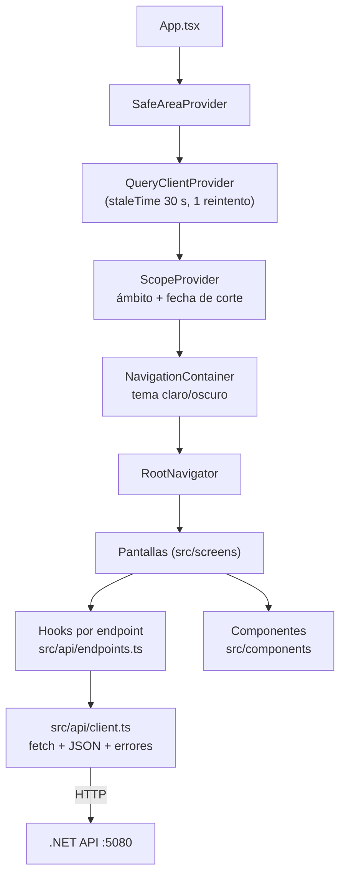
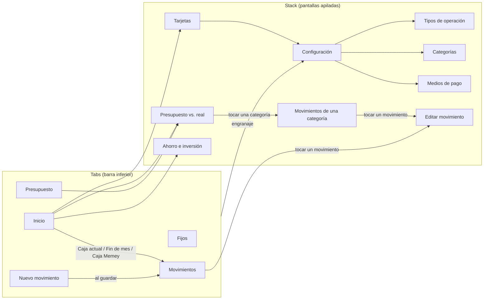

# App mobile

Expo (React Native) con TypeScript, en `mobile/`. Corre en el celular con Expo Go y en el navegador con
`npx expo start --web`. La estructura de carpetas, cómo correrla y el contrato con el backend están en
[mobile/README.md](../mobile/README.md); acá va cómo está armada.

## Componentes principales

| Pieza | Archivo | Qué hace |
| --- | --- | --- |
| Cliente HTTP | `src/api/client.ts` | URL base (`EXPO_PUBLIC_API_URL` o el host de Expo, puerto 5080), JSON, token bearer preparado para cuando haya login, errores como `ApiError` con el mensaje en español del backend |
| Hooks de datos | `src/api/endpoints.ts` | Un hook de React Query por endpoint (`useDashboard`, `useTransactions`, `useCreateTransaction`...). Las mutaciones invalidan las consultas que dependen de ellas |
| Tipos | `src/api/types.ts` | Espejo de los DTOs del backend |
| Estado global | `src/state/scope.tsx` | Ámbito elegido (`familia` o `memey`) y fecha de corte (hoy por defecto, editable) |
| Tema | `src/theme.ts` | Colores claro/oscuro y color por ámbito |
| Formato | `src/utils/format.ts` | Pesos (`$ 1.234.567`) y fechas |

No hay lógica de negocio en la app: saldos, cuotas y proyecciones los calcula la API.

## Navegación

`Movimientos` recibe `{ vista: 'caja', marca: 'corte' | 'finDeMes' }` para abrir el flujo de caja marcando la línea de
la caja actual o la de fin de mes (`src/navigation/types.ts`).

## Pantallas y endpoints

| Pantalla | Para qué | Endpoints |
| --- | --- | --- |
| Inicio | Caja actual, fin de mes, trimestral, Memey, pagos de tarjeta, ahorro | `GET /dashboard`, `GET /savings` |
| Movimientos | Lista de movimientos (filtrable por medio de pago y por categoría del ámbito, con "Todos") y flujo de caja con saldo acumulado; confirmar previstos; tocar un movimiento abre Editar movimiento (mantener apretado lo borra) | `GET /transactions?categoryId&paymentMethodId`, `GET /cashflow`, `POST /transactions/{id}/confirm`, `DELETE /transactions/{id}` |
| Editar movimiento | El mismo formulario que el alta, precargado; guardar o borrar con confirmación | `GET/PUT/DELETE /transactions/{id}`, `GET /cards/{id}/due-date` |
| Nuevo movimiento | Alta con tipo, categoría, medio, cuotas y vencimiento propuesto | `POST /transactions`, `GET /cards/{id}/due-date` |
| Fijos | Gastos fijos con monto vigente por mes | `GET/POST/PUT/DELETE /recurring-rules` |
| Presupuesto | Presupuesto mensual por categoría, uno para Familia y otro para Memey (selector arriba); muestra el total | `GET/PUT /budgets/{month}?scope` |
| Presupuesto vs. real | Reporte de una entidad (Familia o Memey) con fecha de corte y alertas; tocar una categoría abre sus movimientos | `GET /reports/budget-vs-actual` |
| Movimientos de una categoría | Los movimientos que suman el real de la categoría en el mes al corte, con el total; tocar uno abre Editar movimiento | `GET /reports/budget-vs-actual/{categoryId}/transactions` |
| Tarjetas | Cierres y vencimientos por tarjeta | `GET /cards/{id}/cycles` |
| Configuración | Saldos iniciales de cajas, piso, umbrales, cierres de tarjeta | `GET/PUT /settings`, `PUT /settings/cash-boxes/{id}`, `PUT /cards/{id}/cycles` |
| Tipos de operación, Categorías, Medios de pago | Listas editables (lo que está en uso se desactiva) | `/operation-types`, `/categories`, `/payment-methods` |
| Ahorro e inversión | Saldos y movimientos de ahorro e inversiones | `GET /savings` |

Los catálogos (`/people`, `/categories`, `/payment-methods`, `/operation-types`) se piden donde hacen falta para llenar
los combos de los formularios.

## Componentes reutilizables

`src/components/`: `Screen` (contenedor con pull-to-refresh), `Card`, `MoneyText`, `ScopeSelector`, `CutoffControl`
(fecha de corte), `MonthStepper`, `Select` (combo desplegable, usado en todos los formularios), `Segmented`,
`ChipPicker`, `Field`/`Input`/`DateInput`, `FormBits` (`SwitchRow`, `FormButtons`, `NewButton`) y `QueryState`
(carga, error con reintento y vacío).
