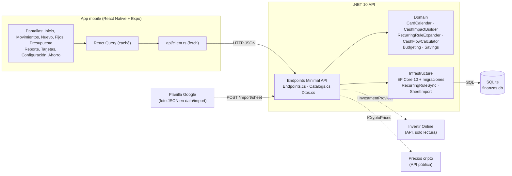
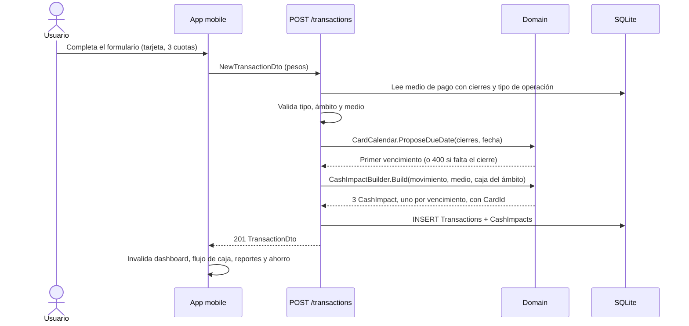
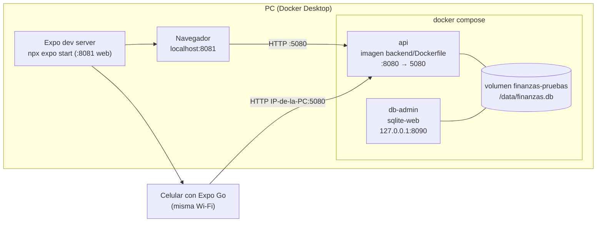

# Arquitectura

La app mobile solo muestra y carga datos; la API .NET calcula caja, cuotas y proyecciones con las reglas de la planilla.
Ver también el [DER](base-de-datos.md), los [diagramas de clases](clases-backend.md), la [app mobile](app-mobile.md) y
las [tecnologías y versiones](tecnologias.md).

## Vista general

## Capas

| Capa | Proyecto o carpeta | Qué hace | Qué no hace |
| --- | --- | --- | --- |
| Presentación | `mobile/` | Pantallas, formularios, caché de consultas, formato de pesos y fechas | No calcula saldos ni proyecciones |
| API | `backend/src/Finanzas.Api` | Rutas HTTP, validación de entrada, DTOs (pesos ↔ centavos), arranque | No guarda reglas de negocio propias |
| Dominio | `backend/src/Finanzas.Domain` | Entidades y reglas puras: impactos en caja, cuotas, proyecciones, presupuesto | No conoce la base ni HTTP |
| Infraestructura | `backend/src/Finanzas.Infrastructure` | EF Core + SQLite, migraciones y datos sembrados, gastos fijos, importación, proveedor de inversiones | — |
| Datos | SQLite (`finanzas.db`) | Un archivo por ambiente | — |

El dominio no depende de nada; la API arma los datos con EF Core y llama a funciones puras del dominio. Eso permite
probar las reglas sin base de datos.

## Flujo: cargar un movimiento con tarjeta

## Editar o borrar un movimiento

`PUT /transactions/{id}` recibe el mismo cuerpo que el alta y pasa por las mismas validaciones. Borra los
`CashImpacts` del movimiento y los vuelve a armar con `CashImpactBuilder` (con tarjeta, si no viene el vencimiento se
propone según los cierres; sin tarjeta, queda en una cuota y sin vencimiento). `DELETE /transactions/{id}` borra el
movimiento con sus impactos. No hay saldos guardados: caja actual, fin de mes, trimestral, pagos de tarjeta y
presupuesto vs. real se calculan al leer, así que reflejan el cambio en la siguiente consulta.

Un previsto generado por un gasto fijo conserva el vínculo con su regla al editarlo. Si después se edita el gasto fijo
(o los cierres de su tarjeta), sus previstos desde el inicio de la regla se vuelven a generar.

El dashboard (`GET /dashboard`) recorre el camino inverso: carga movimientos con sus impactos, cajas, resúmenes,
presupuestos y gastos fijos, y `CashFlowCalculator` calcula caja al corte, fin de mes, trimestral y pagos de tarjeta.

## Despliegue (ambiente de pruebas)

Corre en la PC de Pablo con Docker Desktop; no hay nada en la nube.

- La app toma la URL de la API de `EXPO_PUBLIC_API_URL` o, si no está, del host que sirve Expo, puerto 5080
  (`mobile/src/api/client.ts`).
- La API no tiene login y el CORS está abierto: solo debe exponerse en la red local. El admin de la base escucha solo en
  `127.0.0.1`.
- `scripts/seed-pruebas.sh` (o `.ps1` en Windows) carga la foto de octubre de la planilla en la base de pruebas.

## Reglas que implementa `Finanzas.Domain`

| Regla | Dónde |
| --- | --- |
| La compra con tarjeta va al resumen del primer cierre igual o posterior a la fecha de compra | `CardCalendar.ProposeDueDate` |
| Compra en N cuotas = un movimiento y N impactos en caja; el resto del redondeo va en la primera | `CashImpactBuilder.Build` |
| Cada movimiento tiene un tipo de operación configurable (Configuración → Tipos de operación): en qué ámbitos se ofrece, si suma o resta de caja y su comportamiento (ingreso/gasto, pago de tarjeta, transferencia, ahorro, inversión) | `OperationType`, `CashImpactBuilder.Build` |
| Las transferencias (Aporte a Memey, Retiro de Memey) mueven plata entre cajas sin cambiar el total | `CashImpactBuilder.Build` |
| Ahorro e inversión salen de la caja (o vuelven con Suma) y se ven aparte; no consumen presupuesto | `Savings.BalanceAt` (`GET /savings`) |
| Gastos fijos con medio de pago, vigencia desde-hasta, monto vigente por mes e incrementos % acumulados, previstos hasta diciembre | `RecurringRuleExpander` |
| Caja al corte = saldo inicial + realizados hasta la fecha de corte (hoy por defecto) | `CashFlowCalculator.CashAt` |
| Por tarjeta y vencimiento: el mayor entre modelado, resumen real y pago previsto, menos lo pagado | `CashFlowCalculator.ProjectedAt` |
| El impacto en caja va a la caja del ámbito del movimiento (un gasto familiar pagado con Memey MP sale de la caja familiar) | `CashImpactBuilder.Build` |
| Consumo del presupuesto: movimientos de tipo ingreso/gasto que restan de caja (gastos, cuota del auto) realizados, con tarjeta el día de la compra; las cuotas anteriores a la apertura no consumen | `Budgeting.ConsumesBudget` |
| Proyección del mes: variables al ritmo diario, fijos y deuda el mayor entre presupuesto y real; alertas 70/80/100/120% | `Budgeting.Report` |
| Meses futuros: se descuenta el presupuesto no cubierto por gastos fijos cargados, el día 20 | `Budgeting.MonthlyEstimates` |
| El mes es el mes calendario (del 1.º al último día); un mes sin presupuesto propio hereda el último anterior cargado | `Budgeting.BudgetsFor`, `Budgeting.SourceOf` |
| Proyectar presupuesto: base ajustada por % y redondeada a $1.000; con fijos, Fijo/Deuda toman el fijo del mes y Variable el mayor entre base y fijos | `Budgeting.Propose` |
| Flujo de caja con saldo acumulado: cierra en la caja actual al corte y en la caja a fin de mes | `CashFlowCalculator.Ledger` (`GET /cashflow`) |
| Al crear o cambiar un gasto fijo (o los cierres de su tarjeta) se regeneran sus previstos; los realizados no se tocan | `RecurringRuleSync` |

## Datos

Montos en centavos (`long`), fechas `DateOnly`. Las proyecciones leen solo `CashImpact`. Cierres y vencimientos de tarjeta en `CardCycle`, uno por mes, editables desde Configuración. Detalle de tablas, relaciones y datos sembrados en [base-de-datos.md](base-de-datos.md).

## Endpoints

Montos en pesos, fechas `yyyy-MM-dd`, meses `yyyy-MM`, enums en camelCase (`familia`, `pagoTarjeta`, `realizado`). `scope` acepta `familia` o `memey`: no hay vista total (sin indicar, saldos y reportes son de Familia; los listados traen los dos ámbitos).

| Método y ruta | Para qué |
| --- | --- |
| `GET /health` | Chequeo de vida |
| `GET /openapi/v1.json` | Especificación OpenAPI generada |
| `GET /dashboard?scope&date` | Caja al corte (hoy por defecto), fin de mes, trimestral, gasto estimado de meses futuros, Memey, pagos de tarjeta por mes |
| `GET /cashflow?scope&date&until` | Flujo de caja del mes del corte con saldo acumulado: cierra en la caja actual y en la de fin de mes |
| `GET /transactions?scope&from&to&status&categoryId&paymentMethodId`, `POST /transactions`, `GET/PUT/DELETE /transactions/{id}`, `POST /transactions/{id}/confirm` | Movimientos. Editar o borrar rehace sus impactos en caja: saldos, resúmenes de tarjeta, proyecciones y presupuesto vs. real se recalculan al leer |
| `GET /cards/{id}/due-date?purchaseDate`, `GET/PUT /cards/{id}/cycles` | Vencimiento propuesto y cierres mes a mes |
| `GET/POST /recurring-rules`, `PUT/DELETE /recurring-rules/{id}` | Gastos fijos con vigencia, monto vigente por mes e incrementos % (`amounts[].increasePercent`) |
| `GET /budgets/proposal?scope&source&sourceMonth&from&to&useFixed&increasePct` | Borrador del presupuesto de meses futuros desde el presupuesto de un mes (`budget`) o el real de un mes cerrado (`actual`), con ajuste % (redondeo a $1.000) y gastos fijos de cada mes; no guarda. 400 si el real no es de un mes cerrado, si desde es anterior al mes actual o si son más de 12 meses |
| `PUT /budgets?scope` | Guarda varios meses juntos (`[{month, items:[{categoryId, amount}]}]`); cada mes reemplaza el presupuesto de la entidad |
| `GET /budgets/{month}/source?scope` | Si el mes tiene presupuesto propio o de qué mes lo hereda (`inheritedFrom`) |
| `GET/PUT /budgets/{month}?scope` | Presupuesto mensual por categoría de una entidad (Familia por defecto). Cada categoría es de un ámbito, así que el presupuesto se separa por la categoría; el PUT reemplaza solo el de esa entidad y rechaza categorías de la otra |
| `GET /reports/budget-vs-actual?month&cutoff&scope` | Presupuestado vs real de una entidad con fecha de corte. Si una entidad no cargó el mes, usa su último mes cargado (sin mirar el de la otra) |
| `GET /reports/budget-vs-actual/{categoryId}/transactions?month&cutoff` | Movimientos que forman el real de esa fila (gastos realizados del mes hasta el corte; con tarjeta, el día de la compra) |
| `GET/PUT /settings`, `PUT /settings/cash-boxes/{id}` | Saldos iniciales, piso de caja y umbrales |
| `GET /people` | Personas |
| `GET/POST /operation-types?scope`, `PUT/DELETE /operation-types/{id}` | Tipos de operación. Cambiar el efecto recalcula sus movimientos |
| `GET/POST /categories?scope`, `PUT/DELETE /categories/{id}` | Categorías |
| `GET/POST /payment-methods`, `PUT/DELETE /payment-methods/{id}` | Medios de pago. Lo que está en uso no se borra: se desactiva (`active`) |
| `GET /savings?scope&date` | Saldo de ahorro e inversiones con sus movimientos y el valor de mercado si hay proveedor |
| `GET /investments/dashboard?refresh` | Dashboard de inversiones de Familia: totales en $ y US$, composición, tenencias con los rendimientos de IOL, cotizaciones y señales. Guarda 15 minutos lo traído; `refresh=true` fuerza una consulta |
| `POST /investments/sync?scope` | Igual que `dashboard?refresh=true`. 503 si no hay IOL ni tenencias manuales; 404 para Memey |
| `GET /investments/history?from&to` | Valor total por día (fotos diarias) en $ y US$ |
| `GET /investments/assets/{symbol}/history?market&months` | Serie de precios de un activo (IOL, o cripto con `market=cripto`) |
| `GET/POST /investments/manual`, `PUT/DELETE /investments/manual/{id}` | Tenencias cargadas a mano (Ripio) |
| `GET/PUT /investments/targets` | Cartera objetivo por tipo de activo (suma 100 o vacía) |
| `GET/PUT /investments/settings` | Umbrales de las señales y lista de seguimiento |
| `POST /import/sheet?replace` | Carga una foto de la planilla (`data/import`) |

## Inversiones e Invertir Online

Spec: [Spec/inversiones-dashboard.md](../Spec/inversiones-dashboard.md). Solo Familia.

- El saldo de inversiones de Ahorro e inversión sigue siendo lo aportado neto (movimientos de tipo Inversión).
- **IOL:** `IolInvestmentProvider` (`Finanzas.Infrastructure/InvestmentProviders.cs`) usa la API oficial
  `api.invertironline.com` solo para leer: `POST /token` (usuario y contraseña, después refresh token, todo en memoria),
  `GET /api/v2/portafolio/argentina` y `/estados_Unidos`, `GET /api/v2/estadocuenta` (saldo disponible) y cotizaciones.
  Los rendimientos por activo (`gananciaPorcentaje`, `gananciaDinero`, `variacionDiaria`, `ppc`) se muestran tal cual.
- **Credenciales:** variables `IOL_USERNAME` e `IOL_PASSWORD` en el `.env` de la raíz (ignorado por git). docker compose
  las pasa a la API como `Iol__Username` e `Iol__Password`. Sin ellas se registra `SinProveedorDeInversiones` y todo sigue
  funcionando. La API nunca las devuelve ni las escribe en logs.
- **Dólar MEP:** precio del AL30 en pesos ÷ precio del AL30D en dólares, de las cotizaciones de IOL.
- **Ripio:** no tiene API para cuentas personales. Las tenencias se cargan a mano (`ManualHoldings`) y el precio en USD
  sale de `BinanceCryptoPrices` (API pública sin clave, contra USDT). Con costo cargado, la app calcula el rendimiento y lo
  marca como calculado.
- **Fotos diarias:** cada actualización reemplaza las filas del día en `InvestmentSnapshots` y deja el total en pesos en
  `InvestmentValuations` (lo usan Inicio y Ahorro e inversión). Si IOL falla, el dashboard muestra la última foto con aviso.
- **Señales** (`InvestmentSignals`, en Dominio): A concentración por activo, tipo y moneda; B desvío contra la cartera
  objetivo con el monto a mover; D plata quieta (saldo disponible en el broker y caja proyectada a fin de mes sobre el piso
  de caja). Son informativas, no recomendaciones.
