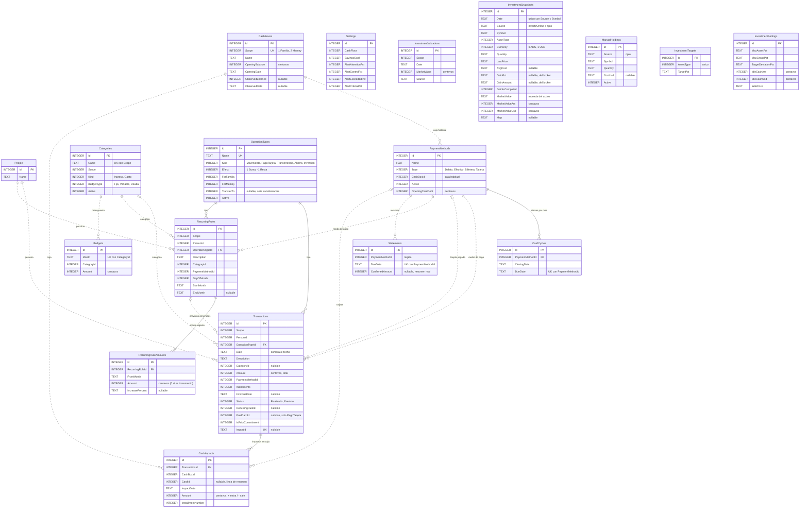

# Base de datos

SQLite, un solo archivo (`finanzas.db`). El esquema lo define EF Core 10 a partir de
`backend/src/Finanzas.Infrastructure/FinanzasDbContext.cs` y se crea o actualiza solo al arrancar la API
(`Database.Migrate()` en `Program.cs`). En el ambiente de pruebas vive en `/data/finanzas.db` dentro del volumen
`finanzas-pruebas`.

## Convenciones

| Qué | Cómo se guarda |
| --- | --- |
| Montos | `INTEGER` en **centavos** (`long`). La API los expone en pesos con hasta 2 decimales. |
| Fechas | `TEXT` `yyyy-MM-dd` (`DateOnly`, sin hora). Los meses se guardan como el día 1 del mes. |
| Enums | `INTEGER` con el valor numérico del enum (ver [Enums](#enums)). |
| Booleanos | `INTEGER` 0/1. |
| Claves | `Id INTEGER` autoincremental en todas las tablas. |
| Ámbito | Columna `Scope` (1 = Familia, 2 = Memey). No es una tabla y no hay ámbito "Total". |

## DER

Líneas continuas: clave foránea real en la base. Líneas punteadas: referencia lógica (columna `...Id` que la API
valida, pero sin `FOREIGN KEY` en SQLite, porque la entidad no tiene navegación configurada en EF Core).



`Settings` e `InvestmentSettings` tienen una sola fila (Id 1). Las tablas de inversiones no se relacionan con otras:
`InvestmentValuations` guarda el valor de mercado total por ámbito y fecha, y `InvestmentSnapshots` el detalle por activo.

## Tablas

### Transactions (movimientos)

Cada ingreso, gasto, pago de tarjeta, transferencia, ahorro o inversión, realizado o previsto. `Date` es la fecha de
compra o del hecho: define el consumo en el presupuesto. El efecto en la caja no se lee de acá sino de `CashImpacts`.

| Columna | Notas |
| --- | --- |
| `Scope` | Ámbito del movimiento. Su caja es la que recibe el impacto, aunque el medio de pago sea de la otra caja. |
| `OperationTypeId` | FK a `OperationTypes` con `ON DELETE RESTRICT`. El tipo define signo y comportamiento. |
| `CategoryId` | Opcional (los pagos de tarjeta y transferencias no llevan categoría). |
| `Amount` | Total de la compra, con intereses si es en cuotas. Siempre positivo; el signo lo pone el tipo. |
| `Installments`, `FirstDueDate` | Con tarjeta: cantidad de cuotas y primer vencimiento (propuesto con `CardCycles`). En un pago de tarjeta, `FirstDueDate` es el vencimiento que se paga. |
| `PaidCardId` | Tarjeta cuyo resumen se paga (solo tipos `PagoTarjeta`). |
| `RecurringRuleId` | Si el movimiento lo generó un gasto fijo. |
| `IsPriorCommitment` | Compra anterior a la apertura: proyecta cuotas pero no consume presupuesto. |
| `ImportId` | Id de la fila de la planilla importada (único), para no duplicar al reimportar. |

Índices: `Date`, `OperationTypeId`, `ImportId` (único).

### CashImpacts (impactos en caja)

Una entrada o salida de caja. **Todas las proyecciones leen solo esta tabla.** Se borran en cascada con su movimiento
y se regeneran cuando cambia el movimiento, su tipo o (para gastos fijos) los cierres de la tarjeta.

- Sin tarjeta: un impacto en la fecha del movimiento.
- Con tarjeta: un impacto por cuota, en cada vencimiento, con `CardId` informado. Son líneas del resumen, no caja
  directa: la caja la mueve el pago del resumen.
- Transferencia: dos impactos, uno negativo en la caja de origen y otro positivo en la de destino.

Índices: `ImpactDate`, `TransactionId`.

### OperationTypes (tipos de operación)

Configurables desde la app. `Kind` define el comportamiento, `Effect` si suma o resta, `ForFamilia`/`ForMemey` en qué
ámbitos se ofrece, `TransferTo` la caja de destino de una transferencia. Lo que está en uso no se borra: se desactiva
(`Active = 0`). Nombre único.

### PaymentMethods, CardCycles y Statements (medios de pago y tarjetas)

- `PaymentMethods`: débito, efectivo, billetera o tarjeta, con su caja habitual. `OpeningCardDebt` es la deuda de la
  tarjeta a la apertura.
- `CardCycles`: cierre y vencimiento de cada tarjeta, uno por mes (único por tarjeta y vencimiento). FK con cascada.
- `Statements`: resumen real de una tarjeta en un vencimiento. Si supera al modelado, manda el real (nunca se suman).
  Hoy se carga por importación de la planilla; la API no tiene un endpoint para editarlo.

### RecurringRules y RecurringRuleAmounts (gastos fijos)

Regla mensual (día del mes, desde/hasta) con medio de pago. El monto tiene historia: cada fila de
`RecurringRuleAmounts` vale desde `FromMonth` hasta el próximo cambio, así cambiar el monto no toca meses anteriores.
Una fila con `IncreasePercent` es un incremento previsto: aplica ese % sobre el monto vigente hasta ese mes
(varios incrementos se acumulan; una fila con monto fijo los reemplaza). La primera fila siempre es un monto.
La vigencia es `StartMonth`–`EndMonth`; sin `EndMonth` se proyecta hasta el horizonte.
La regla genera movimientos `Previsto` en `Transactions` hasta fin de año (mínimo tres meses adelante).

### Categories y Budgets (presupuesto)

Categorías por ámbito (nombre único por ámbito), de ingreso o gasto, con tipo de presupuesto Fijo, Variable o Deuda.
`Budgets` guarda el monto por categoría y mes (único por mes y categoría); si un mes no tiene presupuesto cargado se
usa el último mes anterior que sí tenga.

### CashBoxes (cajas)

Una por ámbito (`Scope` único): "Caja familiar consolidada" y "Memey Mercado Pago". Saldo inicial y fecha de
apertura: los impactos anteriores a la apertura no cuentan.

### Settings e InvestmentValuations

`Settings`: piso de caja, meta de ahorro y umbrales de alerta del presupuesto (70/80/100/120 % por defecto).
`InvestmentValuations`: valor de mercado de las inversiones por ámbito y fecha, con el proveedor que lo informó
(índice por `Scope, Date`). El dashboard deja una por día para Familia.

### Inversiones (dashboard)

- `InvestmentSnapshots`: foto diaria por activo (IOL y Ripio), con las cifras del broker en la moneda del activo y el valor
  convertido a $ y US$ con el MEP del momento. Cada actualización del día reemplaza las filas de ese día. El efectivo
  disponible va como `AssetType` Efectivo (símbolos `ARS` y `USD`).
- `ManualHoldings`: tenencias de Ripio cargadas a mano (cantidad y costo total en USD opcional).
- `InvestmentTargets`: cartera objetivo, % por tipo de activo (suma 100).
- `InvestmentSettings`: umbrales de las señales (25 % por activo, 60 % por tipo o moneda, 5 puntos de desvío, plata quieta
  desde $100.000 o US$100) y lista de seguimiento (`GGAL,nyse:SPY,cripto:BTC`).

Los precios y porcentajes son `decimal`, que SQLite guarda como texto: se suman en memoria, no en SQL.

## Enums

| Enum | Valores |
| --- | --- |
| `Scope` | 1 Familia, 2 Memey |
| `OperationKind` | 1 Movimiento, 2 PagoTarjeta, 3 Transferencia, 4 Ahorro, 5 Inversion |
| `AssetType` | 0 Acciones, 1 Cedears, 2 Bonos, 3 Ons, 4 Fci, 5 Cripto, 6 Efectivo, 7 Otros |
| `InvestmentCurrency` | 0 Ars, 1 Usd |
| `CashEffect` | 1 Suma, -1 Resta |
| `TransactionStatus` | 1 Realizado, 2 Previsto |
| `PaymentMethodType` | 1 Debito, 2 Efectivo, 3 Billetera, 4 Tarjeta |
| `CategoryKind` | 1 Ingreso, 2 Gasto |
| `BudgetType` | 1 Fijo, 2 Variable, 3 Deuda |

## Datos iniciales

Sembrados por la migración (`HasData` en `FinanzasDbContext`):

- **Personas:** 1 Pablo, 2 Rocío, 3 Familia.
- **Cajas:** 1 Caja familiar consolidada (saldo inicial −$143.464 al 01/10/2026), 2 Memey Mercado Pago ($0).
- **Medios de pago:** 1 Débito / transferencia, 2 Efectivo, 3 Memey Mercado Pago, 4 Visa Santander, 5 Visa Galicia,
  6 Master Galicia, 7 Tarjeta Mercado Pago.
- **Tipos de operación:** 1 Ingreso, 2 Gasto, 3 Pago tarjeta, 4 Cuota auto, 5 Ahorro, 6 Aporte a Memey, 7 Retiro de
  Memey, 8 Inversión, 9 Retiro de ahorro, 10 Rescate de inversión. Los ids 1 a 7 son los de la planilla y los usa la
  importación.
- **Settings:** una fila con los valores por defecto.

Categorías, presupuestos, cierres de tarjeta, gastos fijos y movimientos llegan con la importación de la planilla
(`POST /import/sheet`, ver [data/import/README.md](../data/import/README.md)).

## Migraciones

En `backend/src/Finanzas.Infrastructure/Migrations/`:

| Migración | Qué hace |
| --- | --- |
| `20261008191001_InitialCreate` | Esquema inicial y datos sembrados. |
| `20261008194003_CategoryUniqueName` | Nombre de categoría único por ámbito. |
| `20261012014247_TiposDeOperacionAhorroInversion` | Tabla `OperationTypes`: la columna `Operation` (enum) de movimientos y gastos fijos pasa a ser `OperationTypeId` con FK. Agrega `Active` en categorías y medios de pago, y la tabla `InvestmentValuations`. |
| `20261021141201_DashboardInversiones` | Tablas `InvestmentSnapshots`, `ManualHoldings`, `InvestmentTargets` e `InvestmentSettings` (con su fila sembrada). |
| `20261019213123_IncrementoPorcentualEnFijos` | Columna `IncreasePercent` (nullable) en `RecurringRuleAmounts` para los incrementos % previstos de los gastos fijos. Las filas existentes quedan como montos fijos. |

Para crear una nueva (desde `backend/`):

```sh
dotnet tool restore
dotnet ef migrations add <Nombre> -p src/Finanzas.Infrastructure -s src/Finanzas.Api
```

Para ver o editar las tablas a mano, ver "Admin de la base de datos" en el [README](../README.md).
