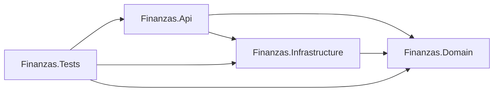
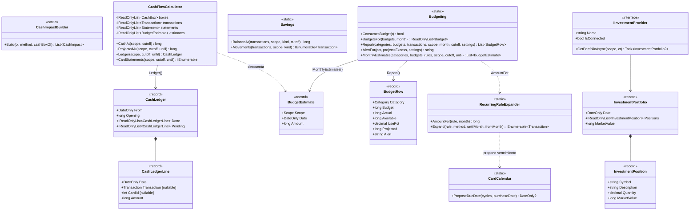
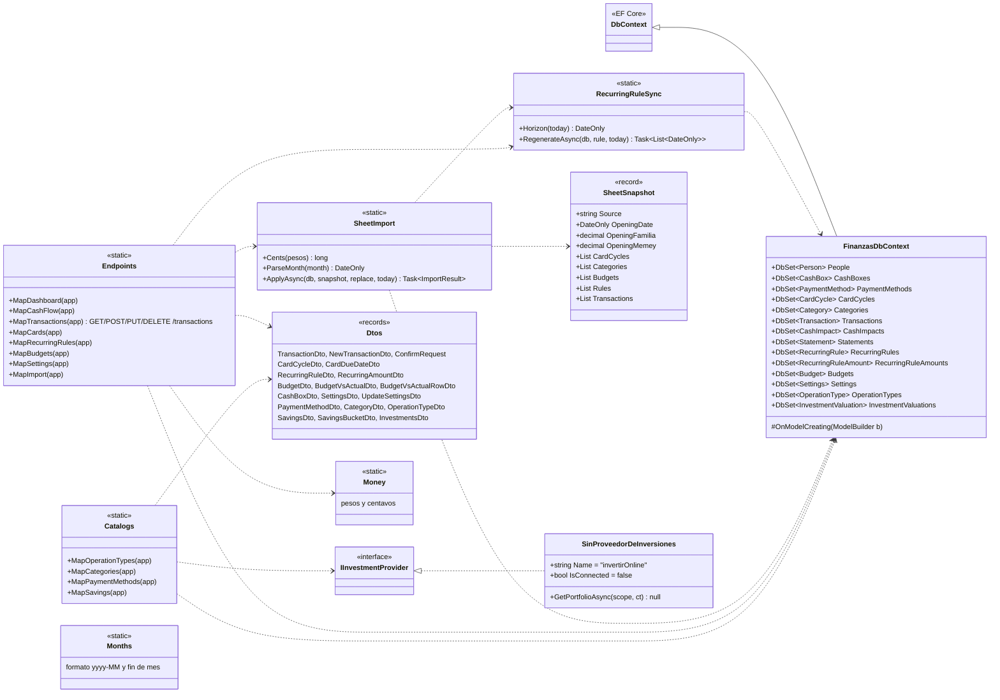

# Diagramas de clases del backend

El backend es una solución .NET 10 (`backend/Finanzas.slnx`) con tres proyectos y uno de tests:

| Proyecto | Contiene | Depende de |
| --- | --- | --- |
| `Finanzas.Domain` | Entidades, enums y reglas de cálculo puras (sin base ni HTTP) | nada |
| `Finanzas.Infrastructure` | `FinanzasDbContext` (EF Core + SQLite), migraciones, sincronización de gastos fijos, importación de la planilla, proveedor de inversiones | Domain |
| `Finanzas.Api` | Minimal API de ASP.NET Core: endpoints, DTOs y arranque | Domain, Infrastructure |
| `Finanzas.Tests` | xUnit: reglas de dominio, API en memoria y comparación contra la planilla de octubre | los tres |

## Dominio: entidades

`backend/src/Finanzas.Domain/Entities.cs`. Montos en centavos (`long`), fechas `DateOnly`. Las asociaciones dibujadas
son las que tienen navegación en C#; las demás referencias son ids (`PersonId`, `CategoryId`, etc.), ver el
[DER](base-de-datos.md#der).

```mermaid
classDiagram
    direction LR

    class Scope {
        <<enumeration>>
        Familia = 1
        Memey = 2
    }
    class OperationKind {
        <<enumeration>>
        Movimiento = 1
        PagoTarjeta = 2
        Transferencia = 3
        Ahorro = 4
        Inversion = 5
    }
    class CashEffect {
        <<enumeration>>
        Suma = 1
        Resta = -1
    }
    class TransactionStatus {
        <<enumeration>>
        Realizado = 1
        Previsto = 2
    }
    class PaymentMethodType {
        <<enumeration>>
        Debito = 1
        Efectivo = 2
        Billetera = 3
        Tarjeta = 4
    }
    class CategoryKind {
        <<enumeration>>
        Ingreso = 1
        Gasto = 2
    }
    class BudgetType {
        <<enumeration>>
        Fijo = 1
        Variable = 2
        Deuda = 3
    }

    class OperationType {
        +int Id
        +string Name
        +OperationKind Kind
        +CashEffect Effect
        +bool ForFamilia
        +bool ForMemey
        +Scope TransferTo [nullable]
        +bool Active
        +int Sign
        +bool IsExpense
        +AppliesTo(Scope scope) bool
    }
    class Person {
        +int Id
        +string Name
    }
    class CashBox {
        +int Id
        +Scope Scope
        +string Name
        +long OpeningBalance
        +DateOnly OpeningDate
        +long ObservedBalance [nullable]
        +DateOnly ObservedDate [nullable]
    }
    class PaymentMethod {
        +int Id
        +string Name
        +PaymentMethodType Type
        +int CashBoxId
        +bool Active
        +long OpeningCardDebt
        +List~CardCycle~ Cycles
        +bool IsCard
    }
    class CardCycle {
        +int Id
        +int PaymentMethodId
        +DateOnly ClosingDate
        +DateOnly DueDate
    }
    class Statement {
        +int Id
        +int PaymentMethodId
        +DateOnly DueDate
        +long ConfirmedAmount [nullable]
    }
    class Category {
        +int Id
        +string Name
        +Scope Scope
        +CategoryKind Kind
        +BudgetType BudgetType
        +bool Active
    }
    class Transaction {
        +int Id
        +Scope Scope
        +int PersonId
        +int OperationTypeId
        +OperationType OperationType
        +DateOnly Date
        +string Description
        +int CategoryId [nullable]
        +long Amount
        +int PaymentMethodId
        +int Installments
        +DateOnly FirstDueDate [nullable]
        +TransactionStatus Status
        +int RecurringRuleId [nullable]
        +int PaidCardId [nullable]
        +bool IsPriorCommitment
        +string ImportId [nullable]
        +List~CashImpact~ Impacts
    }
    class CashImpact {
        +int Id
        +int TransactionId
        +int CashBoxId
        +int CardId [nullable]
        +DateOnly ImpactDate
        +long Amount
        +int InstallmentNumber
    }
    class RecurringRule {
        +int Id
        +Scope Scope
        +int PersonId
        +int OperationTypeId
        +OperationType OperationType
        +string Description
        +int CategoryId
        +int PaymentMethodId
        +int DayOfMonth
        +DateOnly StartMonth
        +DateOnly EndMonth [nullable]
        +List~RecurringRuleAmount~ Amounts
    }
    class RecurringRuleAmount {
        +int Id
        +int RecurringRuleId
        +DateOnly FromMonth
        +long Amount
    }
    class Budget {
        +int Id
        +DateOnly Month
        +int CategoryId
        +long Amount
    }
    class Settings {
        +int Id
        +long CashFloor
        +long SavingsGoal
        +int AlertAttentionPct
        +int AlertControlPct
        +int AlertExceededPct
        +int AlertCriticalPct
    }
    class InvestmentValuation {
        +int Id
        +Scope Scope
        +DateOnly Date
        +long MarketValue
        +string Source
    }

    Transaction "*" --> "1" OperationType
    RecurringRule "*" --> "1" OperationType
    Transaction "1" *-- "1..*" CashImpact : Impacts
    RecurringRule "1" *-- "1..*" RecurringRuleAmount : Amounts
    PaymentMethod "1" *-- "*" CardCycle : Cycles
    OperationType ..> OperationKind
    OperationType ..> CashEffect
    PaymentMethod ..> PaymentMethodType
    Category ..> CategoryKind
    Category ..> BudgetType
    Transaction ..> TransactionStatus
    CashBox ..> Scope
```

## Dominio: reglas de cálculo

`CashFlow.cs`, `Budgeting.cs` e `Investments.cs`. Son funciones puras sobre listas en memoria: la API carga los datos
con EF Core y se los pasa. Por eso se prueban sin base de datos (`CashFlowTests`).

| Clase | Responsabilidad |
| --- | --- |
| `CardCalendar` | Vencimiento del primer cierre igual o posterior a la compra (null si falta cargar el cierre). |
| `CashImpactBuilder` | Convierte un movimiento en impactos de caja: uno directo, uno por cuota con tarjeta, o dos en una transferencia. |
| `RecurringRuleExpander` | Monto vigente de un gasto fijo en un mes y los movimientos previstos mes a mes. |
| `CashFlowCalculator` | Caja al corte, proyección a una fecha, flujo de caja con saldo acumulado y resúmenes de tarjeta pendientes (el mayor entre modelado, real y pago previsto, menos lo pagado). |
| `Budgeting` | Qué consume presupuesto, presupuesto vs real con proyección y alertas, y gasto estimado de meses futuros no cubierto por gastos fijos. |
| `Savings` | Saldo de ahorro o inversión: lo que salió de la caja hacia ellos menos lo que volvió. |
| `IInvestmentProvider` | Punto de conexión con un broker (Invertir Online, pendiente). |

## Infraestructura y API

- `Program.cs` registra `FinanzasDbContext` con SQLite (cadena `ConnectionStrings:Finanzas`, por defecto
  `Data Source=finanzas.db`), CORS abierto, OpenAPI, `SinProveedorDeInversiones` como `IInvestmentProvider` y los enums
  como strings camelCase en JSON. Al arrancar aplica las migraciones pendientes.
- Los endpoints son Minimal APIs agrupados en métodos de extensión (`MapX`) sobre `WebApplication`; no hay
  controladores ni capa de servicios: cada handler carga con EF Core, llama al dominio y arma la respuesta.
- `Money` convierte entre pesos (`decimal`, en la API) y centavos (`long`, en la base). `Months` formatea `yyyy-MM`.
