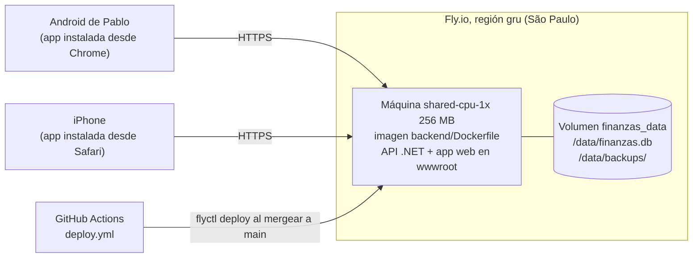

# Despliegue en Fly.io y uso en los celulares

Cómo está publicada la app para usarla desde los celulares (spec: [Spec/despliegue-celulares.md](../Spec/despliegue-celulares.md)).

## Cómo queda



- **Una sola imagen** (`backend/Dockerfile`, se construye desde la raíz del repo): primero exporta la app Expo para web
  (`npx expo export --platform web`) y después publica la API, que sirve esa web desde `wwwroot`. Mismo dominio para
  la app y la API: no hace falta CORS (`Cors__AllowAny=false` en `fly.toml`).
- **La app en el celular es una PWA:** la web instalada en la pantalla de inicio, con ícono y a pantalla completa.
  Sirve igual para Android e iPhone y no necesita tiendas ni cuenta de Apple. Cada deploy les llega a los dos solo.
- **Login:** un usuario por persona (`Auth:Users`), token de 90 días. Todas las rutas lo piden salvo `/health`,
  `/auth/login` y los archivos de la web. 5 intentos de login por minuto por IP.
- **Datos compartidos:** una sola base para los dos usuarios. Lo que carga uno lo ve el otro al refrescar.
- **Hora:** la imagen usa `TZ=America/Argentina/Buenos_Aires`, así "hoy" es el día de Argentina.
- **Costo aproximado:** US$3 a 5 por mes (máquina + disco de 1 GB + snapshots). La máquina se apaga sola cuando nadie la
  usa y se prende con el primer pedido (tarda 1 o 2 segundos).

## Configuración (secrets de Fly)

Nunca van en el repo. Se cargan con `fly secrets set` (cada cambio reinicia la máquina).

| Secret | Qué es |
| --- | --- |
| `AUTH__SIGNINGKEY` | Clave para firmar los tokens, al menos 32 caracteres al azar. Si cambia, se cierran todas las sesiones. |
| `AUTH__USERS__0__USERNAME`, `AUTH__USERS__0__PASSWORD`, `AUTH__USERS__0__DISPLAYNAME` | Primer usuario (Pablo). |
| `AUTH__USERS__1__USERNAME`, `AUTH__USERS__1__PASSWORD`, `AUTH__USERS__1__DISPLAYNAME` | Segundo usuario (su esposa). |
| `IOL__USERNAME`, `IOL__PASSWORD` | Invertir Online (opcional). |

Al arrancar, la API crea los usuarios que faltan y actualiza nombre y contraseña de los que existen. Cambiar la
contraseña de un usuario cierra solo las sesiones de ese usuario. El usuario no distingue mayúsculas.

## Puesta en marcha (una sola vez)

Todo desde PowerShell, en la carpeta del repo.

1. **Instalar flyctl:**
   ```powershell
   iwr https://fly.io/install.ps1 -useb | iex
   ```
   Cerrá y abrí PowerShell para que tome el comando `fly`.
2. **Crear la cuenta y entrar:** `fly auth signup` (o `fly auth login` si ya tenés). Cargá una tarjeta en
   https://fly.io/dashboard → Billing; sin tarjeta Fly no deja crear máquinas.
3. **Crear la app y el disco** (si el nombre está tomado, elegí otro y cambialo también en `fly.toml`, línea `app`):
   ```powershell
   fly apps create mis-finanzas-pablo
   fly volumes create finanzas_data --region gru --size 1 --app mis-finanzas-pablo
   ```
   Fly avisa que un solo volumen no tiene redundancia: aceptá (para eso están los snapshots y las copias diarias).
4. **Generar la clave de firma y cargar los secrets** (cambiá usuarios, nombres y contraseñas):
   ```powershell
   $b = New-Object byte[] 48; [Security.Cryptography.RandomNumberGenerator]::Create().GetBytes($b)
   $clave = [Convert]::ToBase64String($b)
   fly secrets set --stage --app mis-finanzas-pablo `
     AUTH__SIGNINGKEY="$clave" `
     AUTH__USERS__0__USERNAME=pablo AUTH__USERS__0__PASSWORD="una-clave-larga" AUTH__USERS__0__DISPLAYNAME=Pablo `
     AUTH__USERS__1__USERNAME=usuario2 AUTH__USERS__1__PASSWORD="otra-clave-larga" AUTH__USERS__1__DISPLAYNAME=Nombre `
     IOL__USERNAME="usuario-iol" IOL__PASSWORD="clave-iol"
   ```
5. **Primer deploy:** `fly deploy` (construye la imagen en los servidores de Fly, tarda unos minutos). Al terminar,
   `https://mis-finanzas-pablo.fly.dev/health` responde `{"status":"ok"}`.
6. **Deploy automático desde GitHub:**
   ```powershell
   fly tokens create deploy --app mis-finanzas-pablo -x 999999h
   ```
   Copiá el token completo (empieza con `FlyV1`) y cargalo en GitHub → el repo → Settings → Secrets and variables →
   Actions → New repository secret, con nombre `FLY_API_TOKEN`. Desde ahí, cada merge a `main` corre los tests y
   despliega solo (`.github/workflows/deploy.yml`). También se puede lanzar a mano desde Actions → "Deploy a Fly.io" →
   Run workflow.

### Subir la base que ya tenés en la PC (opcional)

Si querés arrancar con lo que cargaste en el ambiente local en vez de una base vacía:

```powershell
docker compose stop api
docker compose cp api:/data/finanzas.db .\finanzas.db
docker compose start api
fly machine start --app mis-finanzas-pablo     # por si está apagada
fly ssh sftp shell --app mis-finanzas-pablo
» put finanzas.db /data/subida.db
» (Ctrl+D para salir)
fly ssh console --app mis-finanzas-pablo -C "mv /data/subida.db /data/finanzas.db"
fly apps restart mis-finanzas-pablo
```

Al arrancar, la API aplica las migraciones que falten y crea los usuarios de los secrets. Borrá después la copia
`finanzas.db` de la carpeta del repo (está en `.gitignore`, pero son tus datos).

## Instalar la app en los celulares

Abrí `https://mis-finanzas-pablo.fly.dev`, entrá con tu usuario y:

- **Android (Chrome):** menú ⋮ → "Instalar app" (o "Agregar a la pantalla principal").
- **iPhone (tiene que ser Safari):** botón Compartir → "Agregar a inicio".

Queda el ícono "Finanzas" y abre a pantalla completa. La sesión dura 90 días; después pide entrar de nuevo.

## Día a día

| Necesito | Cómo |
| --- | --- |
| Publicar un cambio | Mergear el PR a `main`. En unos minutos está en los dos celulares (cerrar y abrir la app). |
| Ver qué pasa en el servidor | `fly logs --app mis-finanzas-pablo` |
| Cambiar una contraseña | `fly secrets set AUTH__USERS__1__PASSWORD="nueva" --app mis-finanzas-pablo` (cierra las sesiones de ese usuario) |
| Cerrar todas las sesiones | Cambiar `AUTH__SIGNINGKEY` |
| Bajar una copia de la base | En la app: Configuración → Cuenta y backup → "Descargar backup" |

## Backups

1. **Copia diaria propia:** la API hace `VACUUM INTO /data/backups/finanzas-AAAA-MM-DD.db` una vez por día (revisa cada
   hora; si la máquina estuvo apagada, la hace al prenderse) y guarda las últimas 30 (`Backup:Keep`).
2. **Snapshots del volumen** que hace Fly todos los días (`snapshot_retention = 5` en `fly.toml`).
3. **Descarga a pedido** desde Configuración (`GET /backup/download`, pide sesión).

Restaurar una copia diaria:

```powershell
fly ssh console --app mis-finanzas-pablo -C "ls /data/backups"
fly ssh console --app mis-finanzas-pablo -C "cp /data/backups/finanzas-2026-11-20.db /data/finanzas.db"
fly apps restart mis-finanzas-pablo
```

Restaurar una copia descargada: igual que "Subir la base que ya tenés en la PC", con ese archivo.

Si se pierde el disco entero: `fly volumes list` → `fly volumes snapshots list <id del volumen>` →
`fly volumes create finanzas_data --snapshot-id <id del snapshot> --region gru --size 1`, y borrar el volumen viejo.

## Ambiente local

`docker compose up -d --build` usa la misma imagen. El login local es `pablo` / `pruebas` (se cambia en el `.env` de la
raíz con `USUARIO_1`, `CLAVE_1`, `NOMBRE_1` y se suma un segundo usuario con `USUARIO_2`, `CLAVE_2`, `NOMBRE_2`). La
app web publicada también queda en http://localhost:5080. Con `npx expo start` la app de desarrollo pide el mismo login.

## Si más adelante quieren app nativa

El código es el mismo. Android: APK gratis con EAS Build (`eas build -p android --profile preview`), con
`EXPO_PUBLIC_API_URL=https://mis-finanzas-pablo.fly.dev`. iPhone: necesita la cuenta de Apple Developer (US$99 por
año) y TestFlight. La sesión en nativo se guarda en el almacenamiento seguro del sistema (`expo-secure-store`).
